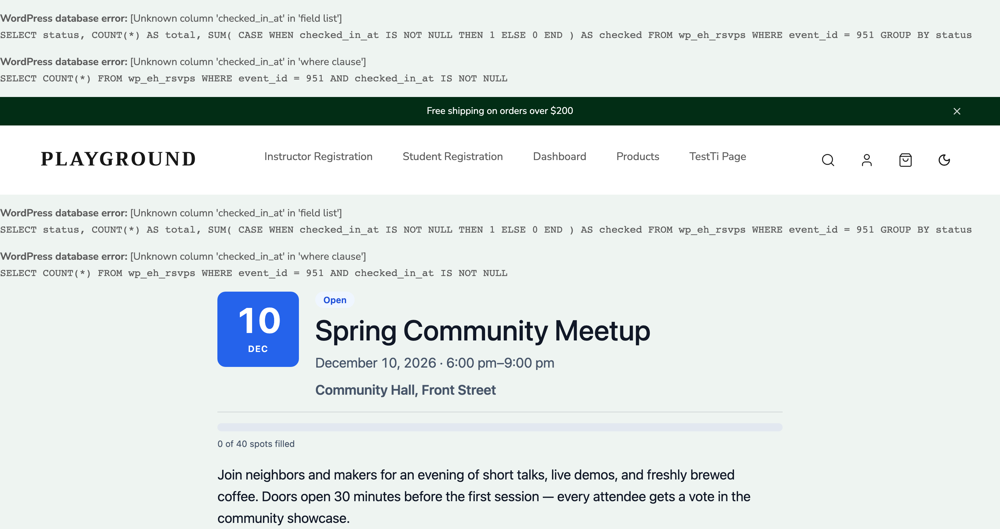
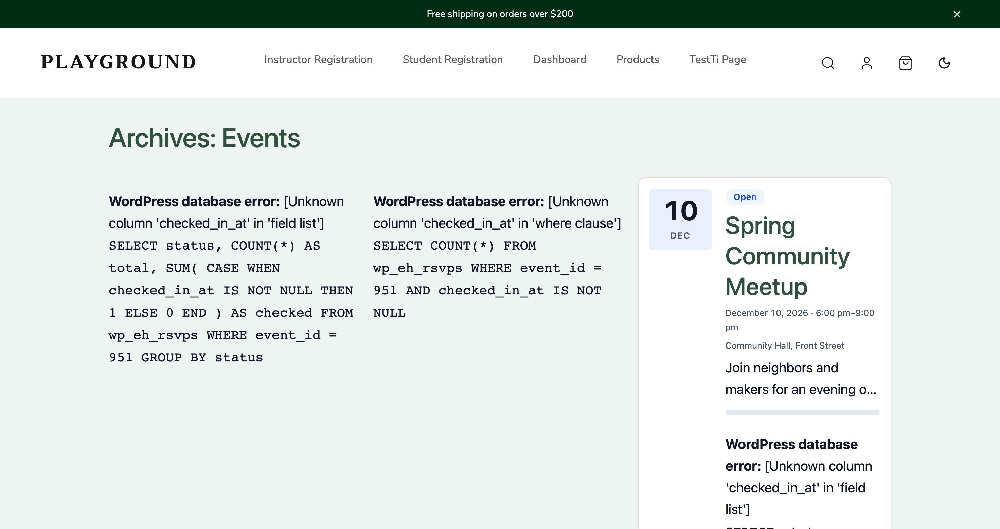
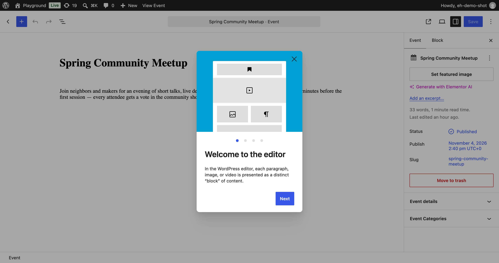
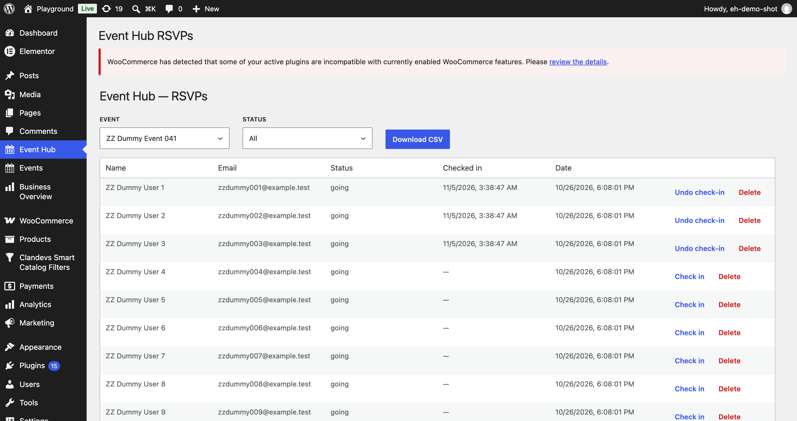

# Event Hub

Events + RSVP plugin for WordPress with capacity-aware registration, waitlist
auto-promotion, and zero-JQuery Interactivity API blocks.

  

## Features

- **Events custom post type** — `eh_event` with start/end datetimes, venue,
  capacity (limited or unlimited), and an `eh_event_category` taxonomy.
- **Capacity-aware RSVP** — atomic `INSERT … SELECT … WHERE going < capacity`;
  when an event fills up, registrations flip to a FIFO **waitlist** automatically.
- **Waitlist auto-promotion** — deleting a "going" RSVP (admin or cancellation)
  promotes the earliest waitlist row in the same advisory-lock window; a
  capacity change below the current count never overbooks.
- **Blocks** — Event List, Event Card, Event Categories, RSVP Button, built on
  the WordPress Interactivity API (server-rendered, progressive enhancement —
  counts and forms work without JavaScript).
- **Privacy-first REST API** — `/wp-json/event-hub/v1/`: anonymous RSVP create,
  per-event counts, admin RSVP list/delete. Attendee emails are never exposed
  publicly; responses are aggregates only.
- **Abuse hardening** — honeypot + HMAC time-trap token, per-IP rate limiting.
- **Exports & feeds** — CSV export per event (admin), ICS calendar feed.
- **Check-in tracking** — organizer "Check in" action per RSVP (REST-gated),
  `checkedIn` count surfaced separately, column in the CSV export.
- **Editor panel** — event meta (dates, venue, capacity) edited in a dedicated
  sidebar panel; admin list-table columns + deep links to each event's RSVPs.
- **WP-CLI** — `wp event-hub-migrate` for the custom-table migration.

## Screenshots

| Single event page | Events archive |
|---|---|
|  |  |

| Editor sidebar panel | Admin RSVP manager |
|---|---|
|  |  |

## Documentation

| Doc | Contents |
|---|---|
| [docs/ROADMAP.md](docs/ROADMAP.md) | Feature backlog; phase tracker + suggested order |
| [docs/ARCHITECTURE.md](docs/ARCHITECTURE.md) | System design, data flow, module map |
| [docs/API.md](docs/API.md) | REST routes, guard rails, form-guard notes |
| [docs/THREAT-MODEL.md](docs/THREAT-MODEL.md) | Threats considered + mitigations (T1–T15) |
| [docs/DECISIONS.md](docs/DECISIONS.md) | Numbered engineering decisions log |

## Development

```bash
npm install          # JS deps (wp-scripts, Playwright, TypeScript)
composer install     # PHP deps (PHPCS, PHPStan, PHPUnit)
npm run build        # Build blocks (webpack via wp-scripts)
npm run typecheck    # tsc --noEmit
npm run lint:js      # ESLint (WordPress preset)
vendor/bin/phpcs     # PHP: WordPress coding standards
vendor/bin/phpstan   # PHP: level 6 static analysis (needs --memory-limit=1G)
```

### Tests

- **PHPUnit** — integration suite against a WordPress core test install:
  `bin/run-tests.sh` (provisions WP + a dedicated DB locally; wp-env in CI).
- **JS checks** — `npm run test` runs the TypeScript typecheck and ESLint
  together (what the CI `js-static` job runs). Jest unit suites and e2e specs
  are not written yet (`tests/e2e/` config exists but is unused; CI enables
  no e2e job).

## Contributing

This is a personal plugin under active development; issues and PRs welcome via
GitHub.

## License

[GPL-2.0-or-later](https://www.gnu.org/licenses/gpl-2.0.html)
